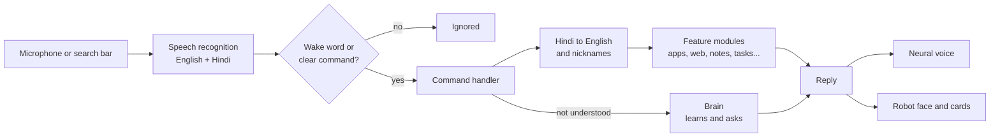

# Sudo Assistant

A voice-controlled desktop assistant for Windows with an animated robot face, a natural speaking voice, English and Hindi understanding, and a small brain that learns from you. It runs as a tiny, transparent, always-on-top window on the edge of your screen.


<!-- Add a screenshot here:  -->

**Quick start**

```bash
git clone https://github.com/Harshvardhan210/sudo-assistant.git
cd sudo-assistant
pip install -r requirements.txt
python main.py
```

---

## Table of contents

- [Features](#features)
- [How it works](#how-it-works)
- [Project structure](#project-structure)
- [Getting started](#getting-started)
- [Using the assistant](#using-the-assistant)
- [Command reference](#command-reference)
- [The learning brain](#the-learning-brain)
- [Configuration and data files](#configuration-and-data-files)
- [Privacy](#privacy)
- [Troubleshooting](#troubleshooting)
- [Limitations](#limitations)
- [Roadmap](#roadmap)
- [Contributing](#contributing)
- [Acknowledgements](#acknowledgements)
- [Author](#author)
- [License](#license)

---

## Features

**Voice and language**
- Continuous listening: click the microphone once and keep talking.
- The wake word `sudo` is optional. Clear commands such as "open notepad" work without it, and normal conversation is ignored.
- Understands English, Hindi and Hinglish, in Roman letters or Devanagari ("volume ko kam kar do", "नोटपैड खोलो").
- Natural, human-like replies with neural voices (Microsoft Edge voices through `edge-tts`), with an automatic offline fallback.
- Headset support: uses your earphones' microphone when they are connected and switches when you plug them in or out.

**Interface**
- Tiny frameless, transparent window that stays on top and sits on the right of the screen.
- Animated robot face with random idle emotions and a working animation while a task runs.
- Double-click the robot to turn it into a search bar and type commands instead.
- A card on the left shows your notes, to-do list or routines.

**Productivity**
- Reminders with a countdown timer on the robot face. The name is spoken three times when time is up.
- Note taking: up to 10 points per note, saved to a text file.
- To-do list that saves automatically and can be ticked off by voice or by clicking.
- Routines: save a list of commands and run or close them with one phrase.

**Computer control**
- Open and close apps (polite close first, force close on request), open folders, find files.
- Volume, time, date, battery, lock, and shutdown/restart with confirmation.
- Google search, open websites, search YouTube, play the first YouTube result.

**A brain that learns (no GPT, no Ollama, no online model)**
- Asks which action you meant when it is unsure, then retrains immediately.
- Asks for the answer to questions it doesn't know and remembers them.
- Nicknames ("call chrome as browser"), usage counts, and a log of messages it didn't understand.
- Everything it learns is stored in readable JSON files.

---

## How it works



- **Listening** runs in a background thread and sends recognised text to the command handler.
- **The command handler** routes each sentence to a feature module. If nothing matches, the brain tries to understand it from what it has learned, or asks you.
- **The UI** is an HTML page shown in a Qt WebEngine view and connected to Python with QWebChannel, so the robot face reacts to what the assistant is doing.

---

## Project structure

```text
sudo-assistant/
├── main.py                      # entry point
├── requirements.txt
├── assistant/
│   ├── command_handler.py       # routes every command to the right feature
│   ├── voice_input.py           # continuous listening, wake word, English + Hindi recognition
│   ├── voice_output.py          # neural voice, offline fallback, voice settings
│   ├── hindi_commands.py        # Hindi / Hinglish -> English commands
│   ├── wake_mode.py             # "sudo" optional or required, command filter
│   ├── audio_devices.py         # headset / laptop microphone selection
│   └── brain.py                 # learning: intents, answers, nicknames, habits
├── features/
│   ├── app_launcher.py          # open apps
│   ├── app_closer.py            # close apps safely
│   ├── file_search.py           # find files and folders
│   ├── system_control.py        # time, date, battery, volume, lock, shutdown
│   ├── web_tools.py             # Google, websites, YouTube
│   ├── reminder.py              # reminders with countdown
│   ├── notes.py                 # note taking (max 10 points)
│   ├── todo.py                  # to-do list
│   └── routines.py              # saved command routines
├── gui/
│   ├── mini_window.py           # frameless transparent window
│   └── assistant_bridge.py      # Python <-> web page bridge, listening thread
├── frontend/
│   ├── code.html                # robot face, search bar and cards
│   └── qwebchannel.js           # copied from Qt automatically on first run
├── brain/                       # created on first run (learned data)
├── notes/                       # created when you save notes
├── todo/                        # created when you add a task
└── routines/                    # created when you save a routine
```

---

## Getting started

### Requirements

- Windows 10 or 11
- Python 3.10 or newer
- A microphone and an internet connection (speech recognition and the neural voice are online services)

### Installation

```bash
git clone https://github.com/Harshvardhan210/sudo-assistant.git
cd sudo-assistant

python -m venv venv
venv\Scripts\activate

pip install -r requirements.txt
```

The main packages are:

| Package | Used for |
| --- | --- |
| `PySide6` | window, web view, WebChannel, audio device detection |
| `SpeechRecognition` and `PyAudio` | microphone input and speech to text |
| `edge-tts` | natural neural voice |
| `pyttsx3` | offline backup voice |
| `psutil` | closing apps safely |

If `PyAudio` fails to install on Windows, try `pip install pipwin` followed by `pipwin install pyaudio`.

### Run

```bash
python main.py
```

The robot appears on the right edge of the screen. Click the microphone button and start talking.

---

## Using the assistant

| Action | How |
| --- | --- |
| Start listening | Click the microphone button once |
| Stop listening | Click the stop button |
| Give a command | Say it, with or without `sudo` |
| Type instead | Double-click the robot, type, press Enter |
| Back to voice | Double-click the search bar, or press Esc |
| Move the window | Drag the robot or the top strip |
| Close the app | Click the ✕ button |

Some commands always need `sudo` because they are risky: shutdown, restart, delete, clear, kill, force, and the brain commands `call` and `forget`.

---

## Command reference

Say `sudo` first if you switched the wake word on (`wake word on`).

### Apps, files and system

| Say | Result |
| --- | --- |
| `open notepad`, `open downloads` | Opens an app or folder |
| `close notepad`, `force close chrome` | Closes an app (polite close first) |
| `find my resume`, `open result 1` | Searches files and opens a result |
| `what time is it`, `what is today's date`, `battery status` | Information |
| `volume up`, `volume down`, `mute`, `unmute` | Volume |
| `lock computer` | Locks the PC |
| `shutdown`, then `confirm shutdown` | Shuts down after confirmation |

### Web

| Say | Result |
| --- | --- |
| `google python tutorials` | Google search |
| `search youtube for lofi music` | YouTube results |
| `play shape of you` | Plays the first YouTube result |
| `open youtube`, `open github.com`, `go to flipkart` | Opens a website |

### Reminders

| Say | Result |
| --- | --- |
| `remind me in 5 minutes` | The robot asks for the name, then shows a countdown |
| `remind me to drink water in 10 minutes` | Sets it directly |
| `cancel reminders` | Cancels all reminders |

### Notes

| Say | Result |
| --- | --- |
| `add a note` | The robot asks what to write. Each sentence you say becomes the next point (max 10) |
| `save notes` | Saves the points to `notes/notes.txt` |
| `open notes`, `close notes` | Shows or hides the notes card |
| `delete last point`, `cancel notes` | Edit or discard |

While taking notes, anything you say without `sudo` is written as a point. Start with `sudo` to give a normal command.

### To-do list

| Say | Result |
| --- | --- |
| `add task buy milk` | Adds a task (or say `add a task` and answer the question) |
| `show my tasks` | Opens the to-do card |
| `mark task 2 as done`, `undo task 2` | Ticks or unticks |
| `delete task 3`, `clear completed tasks` | Removes tasks |

### Routines

| Say | Result |
| --- | --- |
| `create routine`, then the name | Starts a routine |
| `add open naukri, open youtube, open vs code` | Adds steps |
| `close work routine` | While creating: saves it. Afterwards: closes the apps it opened |
| `run work routine` | Runs every step |
| `show routines`, `delete work routine` | Manage routines |

### Robot settings

| Say | Result |
| --- | --- |
| `change voice`, `male voice`, `female voice` | Voice |
| `speak faster`, `speak slower` | Speed |
| `use headphones`, `use laptop mic`, `use automatic audio` | Microphone |
| `which mic are you using` | Shows microphone and output |
| `wake word on`, `wake word off` | Require `sudo` or not |

### Hindi and Hinglish

| Say | Result |
| --- | --- |
| `volume ko kam kar do`, `awaaz badhao` | Volume down / up |
| `notepad kholo`, `chrome band karo` | Open / close an app |
| `5 minute baad yaad dilao` | Reminder |
| `work routine shuru karo` | Runs a routine |
| `aaj ki date kya hai`, `kitne baje hain` | Date and time |

---

## The learning brain

The brain is plain Python. It compares your words with example sentences and needs no external model.

| You do | It does |
| --- | --- |
| Say something it isn't sure about | Lists up to three actions. Your choice is saved as a new example in `intents.json` and the model retrains immediately |
| Ask a question it can't answer | Asks what to answer and saves the pair in `qa.json` |
| `call chrome as browser` | Saves a nickname in `memory.json` |
| `forget <question>` | Deletes a taught answer (or a wrongly taught phrase) |
| `forget alias browser` | Deletes a nickname |
| `my habits` | Shows how often you use each action |
| `what have you learned` | Short summary |
| Say something it doesn't understand | Writes it to `unknown.txt` |

Example: say `sudo fire up notepad`, answer `open app`, and from then on `fire up chrome` works, even without `sudo`.

---

## Configuration and data files

| File | Purpose |
| --- | --- |
| `brain/intents.json` | Actions and their example sentences (editable) |
| `brain/qa.json` | Questions and answers you taught |
| `brain/memory.json` | Nicknames and usage counts |
| `brain/unknown.txt` | Messages it didn't understand |
| `notes/notes.txt` | Saved notes |
| `todo/todo.txt` | To-do list (`[ ]` to do, `[x]` done) |
| `routines/routines.json` | Saved routines |
| `assistant/voice_settings.json` | Voice, speed and volume |
| `assistant/audio_settings.json` | Microphone mode and an optional headset keyword |
| `assistant/wake_settings.json` | Wake word and Hindi options |

Window size and position are set at the top of `gui/mini_window.py` (`ZOOM`, `VERTICAL_POSITION`, `SCREEN_MARGIN`).

---

## Privacy

- Everything you say near the microphone is sent to Google's speech recognition service to be turned into text.
- Text the robot speaks is sent to Microsoft's online voice service. Repeated sentences are cached locally.
- YouTube video lookup contacts YouTube.
- Notes, tasks, routines, answers, nicknames and usage counts stay on your computer in plain files.

---

## Troubleshooting

| Problem | What to try |
| --- | --- |
| The window looks unstyled | The page loads its design from the internet. Check your connection |
| The transparent area is black | Add `os.environ["QTWEBENGINE_CHROMIUM_FLAGS"] = "--disable-gpu"` at the very top of `main.py` |
| No natural voice | Run `pip install edge-tts` and check the internet. Without it, the offline voice is used |
| It listens to the wrong microphone | Say `which mic are you using`, then `use headphones` or `use laptop mic` |
| A headset is not recognised | Put a word from its name into `assistant/audio_settings.json` as `"input_keyword"` |
| It reacts to other people talking | Say `wake word on` to require `sudo` |
| `ImportError: cannot import name 'run_app'` | `gui/mini_window.py` is not the right file. It must end with `def run_app()` |
| The terminal shows `JS [...]` lines | Page messages. Errors there usually point to an outdated `frontend/code.html` |

---

## Limitations

- Windows only: app closing, audio playback and some features use Windows services.
- Online services are needed for speech recognition, the natural voice and the page design.
- Hindi understanding uses a fixed list of phrasings. Replies are in English.
- The brain only knows its example sentences and what you teach it. It is not a general question-answering model.
- Playing a YouTube video depends on YouTube's page layout and may fall back to showing search results.
- Bluetooth earbuds switch to a lower-quality call mode while their microphone is in use.

---

## Roadmap

- Offline wake-word detection, so audio is only sent after "sudo"
- Bundle the interface assets for fully offline use
- Replies in Hindi
- Installer (`.exe`) and automated tests

---

## Contributing

Ideas, bug reports and pull requests are welcome.

1. Fork the repository and create a branch: `git checkout -b feature/my-feature`
2. Make your change and test it by running `python main.py`
3. Commit with a clear message and open a pull request

When reporting a bug, please include your Windows version, Python version and the terminal output.

---

## Acknowledgements

- [Qt for Python (PySide6)](https://doc.qt.io/qtforpython-6/) for the window and web view
- [SpeechRecognition](https://github.com/Uberi/speech_recognition) for microphone input
- [edge-tts](https://github.com/rany2/edge-tts) for the natural voice
- [Tailwind CSS](https://tailwindcss.com/) and Google Fonts for the interface design

---

## Author

**Harshvardhan Tiwari**

- GitHub: [github.com/Harshvardhan210](https://github.com/Harshvardhan210)
- Portfolio: [htprofile.netlify.app](https://htprofile.netlify.app)

---

## License

Released under the MIT License. See the `LICENSE` file for details.
